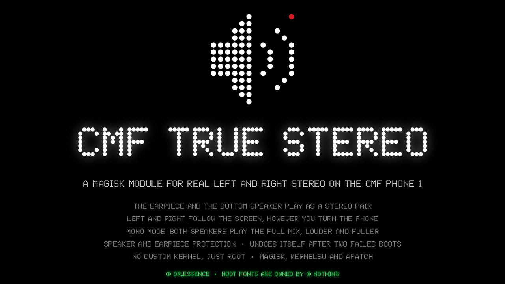

<p align="center"></p>

# CMF-true-stereo

**Real left/right stereo on the CMF Phone 1.** The earpiece becomes the left
speaker, the bottom speaker the right — no custom kernel, just root.

<p align="center">
  <a href="https://github.com/Dr-Essence/CMF-true-stereo/releases/latest"><b>Download the module</b></a> ·
  <a href="https://github.com/Dr-Essence/CMF-true-stereo-manager/releases/latest"><b>Get the app</b></a> ·
  <a href="#mono-and-stereo">How stereo works</a>
</p>

|  | |
|---|---|
| 🔊 **Stereo** | Earpiece = left, speaker = right. Games, films and music finally have sides. |
| 📢 **Mono** | Default. Both speakers play the full mix: louder and fuller than the bottom speaker alone. |
| 📱 **App** | *CMF Stereo*, a clean Nothing-style app: on/off, Mono/Stereo, two 1–10 levels. |
| 🛟 **Safe** | Patches nothing it has not verified, never touches the vendor partition, and undoes itself after two failed boots. |

### Install in three steps

1. Flash the zip in **Magisk / KernelSU / APatch** and reboot.
2. Open **CMF Stereo** and pick **Stereo**, or tap **Action** on the module's card in Magisk,
   or in a terminal: `su -c stereoctl channels stereo`.
   It switches at once (the sound stops for a moment; press play again).
3. Turn the phone sideways either way: left and right follow the screen.

Works on the **CMF Phone 1 (A015)**. On any other phone it installs and does
nothing.

> **Before you use stereo**
> - Stereo turns off Awinic's speaker protection for media (calls always keep
>   it). To make up for it, the speaker is held **6 dB below the amp's full
>   output** at its loudest (app speaker level 10), and each level down takes
>   2 dB more, to 24 dB at level 1. Use **Mono** for loud listening.
> - If the phone fails to boot twice in a row with stereo on, the module
>   removes stereo on its own and falls back to Mono.
>
> Details in [Mono and stereo](#mono-and-stereo).

## Status

**Current release: v0.9.9** (CMF Phone 1, Nothing OS B4.1, Android 16). Stereo works and is
in daily use on the test phone. Mono and Stereo switch without a reboot, left and right
follow the phone's orientation, and Magisk offers new releases as updates. v0.9.9 fixes the
Action button's switch to Stereo (it crashed the audio service), makes a failed switch fall
back safely, and decides the orientation swap by Nothing's Dirac tuning instead of the output.

**Verified on the phone**
- v0.9.9 orientation swap by Dirac's tuning: the left-only file in USB Audio Player Pro
  (Android driver; Dirac MUSIC) and VLC (Dirac MOVIE), earpiece on either side: both right.
- v0.9.9 Action button: switching Mono and Stereo from Magisk works; the audio service kept
  running (v0.9.8 crashed it on the switch to Stereo). One try left UAPP crashing once; it
  did not happen again.
- v0.9.9 orientation swap in apps and games: YouTube (on Nothing's video list, Dirac MOVIE:
  the module swaps) follows the rotation, and a game (The Amazing Spider-Man 2, 64-bit port,
  on no list: Dirac MUSIC) switches sides when turned.
- Magisk's Update button: with v0.9.6 installed, Magisk showed **Update** for this module
  once v0.9.7 was out and `update.json` named it (before that it rightly showed none).
- Updating from that button to v0.9.7 and rebooting: the module is now listed as v0.9.7 by
  Dr.Essence.
- v0.9.5 orientation swap: the left-only test file in VLC (deep-buffer output) and in USB Audio
  Player Pro (primary output, where Nothing's Dirac does the swap): earpiece on your left, the
  earpiece plays; on your right, the speaker plays. (Then UAPP played on the primary output
  in Dirac's MUSIC tuning; v0.9.9 replaced the output rule, see Fixed.)
- v0.9.8 Action button, live card text and Update button: Action switched Mono, the card
  showed v0.9.8 by Dr.Essence. Action's switch back to Stereo crashed the audio service
  (fixed in v0.9.9).
- v0.9.4 live switching: Mono -> Stereo -> Mono -> Stereo with `stereoctl channels`, no reboot,
  each checked with the left-only test file (speaker silent in Stereo, both play in Mono).
  The first two builds refused it safely (no stock copy; then mounting over the deleted
  files Magisk had mounted), which is what the final design fixed.
- v0.9.4 kernel log: boot messages intact, one `aw882xx_volume_put` at boot instead of a
  `volume_get` line every cycle.
- Stereo: a left-only test file leaves the speaker silent on its right slot and plays on the
  earpiece, with Nothing's Dirac tuning on and off.
- Mono and stereo switching through `stereoctl channels` and the app, with a reboot.
- Restarting the audio HAL by hand (`setprop ctl.restart vendor.audio-hal`) while playing:
  the HAL came back, players paused, calls worked.
- One daemon per boot (three were starting before v0.9.1).
- Earpiece at +8 dB (`Handset Volume 0`) while playing; the old 31 is corrected on install.
- Hi-res playback (USB Audio Player Pro, Direct 192 kHz) still works in stereo.

**Not tested on a phone yet**
- v0.9.8 Action button: Magisk's **Action** on the module's card switches Mono <-> Stereo
  through `stereoctl channels` and prints its output. Checked: the script parses under
  dash, mksh and busybox and is packaged; not yet pressed on the phone.
- v0.9.8 live description: the card's first words say `[Stereo]`, `[Mono]`, `[Off]`, a switch
  waiting for a reboot, a daemon that is not running, or `[Stereo unavailable]` after a
  Nothing OS update. Covered by the tests (state text, one line, file left alone when nothing
  changed); needs a look on the phone after a switch and after a reboot.
- v0.9.8 Nothing OS update guard: before Magisk mounts, a staged stereo overlay is removed
  (mono) if the vendor audio files are not the analysed build, instead of mounting a HAL
  patched from the old build over the new one; the card and `stereoctl status` then say
  stereo is unavailable. Tested on fake vendor files (different HAL, different DSP config,
  missing HAL); seen on the phone only with the next Nothing OS update.
- v0.9.9: games on Nothing's game list (Dirac GAME, e.g. PUBG Mobile) and navigation apps
  (SPEECH): whether Dirac swaps in those tunings. Apps Nothing blacklists (Dirac off) should
  be swapped by the module. Games that play through AAudio's MMAP path would bypass the swap.
- v0.9.9: a failed live switch ending on the stock files (tested on bind mounts over a
  Magisk-style skeleton; no failure has happened on the phone since).
- Live switching from the app's Mono/Stereo buttons.
- v0.9.3: on/off speed and the lighter daemon. Passes the test suite under mksh (Android's
  shell), dash and busybox; needs a check on the phone: `time su -c stereoctl off`, then
  `time su -c stereoctl on`, and the earpiece still engaging when audio starts.
- The boot watchdog removing the stereo overlay after two failed boots (no failed boot has
  happened to trigger it).
- Re-staging stereo during a module update, and the refusal on a different Nothing OS build
  (needs the next OTA).
- How the speaker holds up to long, loud stereo listening without Awinic's protection.

**Pending**
- Speaker limiter, earpiece boost and EQ (asked for; design stage). Where it can run: the
  HAL's playback path calls `doStereoToMonoConversionIfNeed` (our swap) for every speaker
  stream, including USB Audio Player Pro's direct hi-res output, before the DSP, which runs
  MediaTek's pass-through `aurisys_demo` in stereo. An Android audio effect from the app would
  miss direct outputs, so a limiter meant to protect the speaker has to sit in the HAL path.
  Needs, before any build: whether the host-side Aurisys step after it
  (`aurisys_process_dl_only` in `AudioALSAPlaybackHandlerDsp::write`) adds gain, and the
  user's bass tests (Mono vs Stereo, STEREO_ATTEN_DB 6 vs 12).
- Balance: already there as the app's two levels (earpiece level, speaker level in stereo).
- Hardware checked (I2C devices, driver bindings, mixer, HAL): one Awinic amp at `6-0034`
  (mono output, speaker only); the earpiece is on the codec's left DAC, which takes only
  channel 1; the codec's earpiece amp is at its top step (+8 dB) and the digital path has
  about 0.3 dB left. Ideas under consideration: an earpiece boost (high-pass, compressor and
  limiter on the earpiece channel through Android's DynamicsProcessing, in the app), and a
  mono speaker fallback when the phone is turned with the earpiece on the right (a true
  left/right swap would need the channels swapped in the stream: a bigger project).
- Which stereo speaker level sounds as loud as stock (Mono, with Awinic's protection): needs a
  by-ear comparison on the phone, level by level, with the same track.
- A short clip of the earpiece and speaker splitting a game's or film's audio, for the README
  and the release page.
- Check the vendor file hashes after the next Nothing OS update and add the new build.
- `ADDA_DL_MAX_VOL` was tried for a louder earpiece: no clear difference, left out.

**Fixed recently**
- v0.9.9: the Action button's switch to Stereo crashed the audio service until a reboot.
  Magisk starts `action.sh` as `./action.sh`, so the module folder was "."; the stereo file
  was then mounted from `./system/...` resolved at init's root, i.e. `/vendor/...` itself:
  Magisk's empty placeholder (Magisk 31 builds `/vendor/lib64/hw` as a tmpfs skeleton).
  The failed switch then took the module's mounts off and restarted the HAL on those empty
  files; audioserver crash-looped (`stoi: no conversion`) and `system_server` and
  `audioserver` used a lot of CPU. Now the folder is always absolute, and a failed switch
  mounts the checked stock copies and restarts the HAL only once all three files read back
  as stock; otherwise it leaves the running HAL alone and asks for a reboot.
- v0.9.9: USB Audio Player Pro played reversed with the earpiece on the right once it played
  on the deep-buffer output. Measured: Nothing's audio service gives each app a Dirac
  tuning (VLC is on its video list -> MOVIE; apps on no list, like UAPP -> MUSIC), and only
  MUSIC swaps left and right with the rotation itself. The swap now follows
  `persist.vendor.newdirac.cur.config` / `.enable.value` instead of skipping the primary
  output.
- v0.9.8: after a Nothing OS update the old stereo overlay (patched from the previous build)
  would still have been mounted over the new vendor files; only two failed boots removed it.
- v0.9.7: the module was still listed in Magisk as by Tiimoo-debug; it now says Dr.Essence.
- v0.9.6: Magisk showed an out-of-date module description (Stereo "needs a reboot").
- v0.9.5: turned with the earpiece on your right, left and right came out reversed.
- v0.9.4: switching Mono and Stereo needed a reboot; it now restarts only the audio HAL.
  From a stereo boot, the stock files are rebuilt from the stereo ones (original bytes back,
  then hash-checked), so mono can be switched to live without ever having booted mono.
- v0.9.4: the daemon read the amp's volume every cycle, and the Awinic driver logs each read,
  so dmesg filled with `aw882xx_volume_get` lines (about 20 a minute) and lost the boot
  messages.
- v0.9.3: every mixer read started tinymix three times and every write five (its style check
  was cached inside a subshell and thrown away), on every 2 s daemon cycle. It is now detected
  once per process.
- v0.9.3: on/off waited on fixed sleeps: up to 2 s for the daemon to notice the stop, 1 s
  polling for it to exit, and a flat 2 s after restarting it. The daemon now stops the moment
  it is told to and both waits poll in tenths of a second.
- v0.9.3: finding the daemon started two programs for every process on the phone (several
  hundred), at least twice per on/off. It now checks only shells and the daemon itself.
  Measured in a test container with a running daemon: `on` 0.05 s, `off` 0.18 s.
- v0.9.3: `stereoctl status brief` for the app, without reading every control back.
- v0.9.2: earpiece gain was 31 (the codec's mute value), not the maximum.
- v0.9.1: three daemons fought over the mixer; `status` reported "not running".
- v0.9.0: true stereo: the HAL and Awinic DSP mono folds switched off in stereo mode.

---

## About

A Magisk / KernelSU / APatch module that makes the **CMF Phone 1** play media
out of its **earpiece as well as its bottom speaker** — in true stereo if you
want it.

It has two channel modes:

- **mono** (default, stock audio): both drivers play the same full mix —
  louder, fuller and taller than the single bottom-firing speaker. This was
  the whole module once, back when it was called cmf-fake-stereo.
- **stereo**: real left/right. The **earpiece plays the left channel and the
  speaker the right**. It costs Awinic's speaker-protection processing on
  media, so the speaker amp is held at a fixed attenuation instead. See
  [Mono and stereo](#mono-and-stereo).

Getting stereo took finding the two places the phone folds the speaker to
mono; the [Findings](#findings-what-this-device-actually-does) section shows
the measurements rather than asking you to take my word.

Verified on **A015 / Tetris, MT6878, Nothing OS B4.1, Android 16.**

## What it does

- **Real stereo** in stereo mode: earpiece = left channel, bottom speaker = right
- **Mono** mode: both speakers play the full mix, with full speaker protection
- Plays media through the earpiece alongside the speaker, automatically
- Earpiece at the receiver amp's maximum, +8 dB (`Handset Volume 0`), the same value the HAL uses
- Applies only while audio is playing, so the receiver is not held energised
- Steps aside for headphones and Bluetooth
- Restores every control it touches on stop, disarm or uninstall
- Disarms itself if it ever causes a failed boot
- Switch modes with `stereoctl channels mono|stereo`, the app, or the Action button on
  the module's card in Magisk / KernelSU / APatch; the stereo overlay removes itself after
  two failed boots
- Says on the module's card what is running: `[Stereo]`, `[Mono]`, `[Off]`, or
  `[Stereo unavailable]` after a Nothing OS update

## What it does not do

- **No speaker protection on media in stereo.** Awinic's DSP processing is the
  part that folds to mono, so stereo replaces it (see [Mono and stereo](#mono-and-stereo)).
- **No extra volume from the main speaker.** It is untouched.
- **Nothing on other devices out of the box.** It installs inert elsewhere and
  ships a probe to work out that device's routing.

## Quick start

Flash the zip (build it with `./build.sh`, or grab a release), reboot, play
something. That is the whole setup on a CMF Phone 1 — the verified routing is
preconfigured.

To check it is working, with audio playing:

```sh
su
stereoctl status     # all three controls should show want= matching now=
stereoctl solo       # speaker off, earpiece only - proves it is really the earpiece
stereoctl unsolo
```

For real stereo (applied at once):

```sh
su -c stereoctl channels stereo
```

If it is ever silent, `stereoctl doctor` walks every layer that can cause that
and names the one responsible.

## On other devices

It installs with an empty `actions.conf` and changes nothing. Run
`stereoctl probe` to dump the audio hardware — ALSA topology, every mixer
control, smart-amp drivers, HAL configs and MediaTek's AudioParam tree — then
`stereoctl report` to fold it into one shareable text file. The routing for
that device gets written into `actions.conf` from what the probe finds. See
[Why it ships empty elsewhere](#why-it-ships-empty-elsewhere).

---

## How it works

Three layers, smallest hammer first.

**1. Mixer actions (`actions.conf`).** The real work. An ALSA mixer control
somewhere enables the receiver output stage; on MediaTek there is usually also
a routing control that decides which DL (downlink) stream feeds it. Setting
those while the speaker is playing is what puts the earpiece to work next to
the speaker.

The audio HAL rewrites mixer controls on every route change, so a one-shot
write does not survive the next stream start. A small daemon re-asserts the
values every couple of seconds and — by default — only while audio is actually
playing, so the earpiece is not left energised all day.

Everything touched has its original value saved under
`/data/adb/cmf-stereo/state/` and restored on stop, disarm or uninstall.

**2. Audio policy overlay (`stereoctl xml-patch`, optional).** If the policy
declares the speaker as `AUDIO_CHANNEL_OUT_MONO`, the framework downmixes to
one channel before the HAL ever sees it, and no amount of mixer work brings
the second channel back. The patch widens only the speaker `<devicePort>` to
stereo, in an overlay copy — the vendor partition is never written. It is
opt-in, validated before it is installed, and reversible.

**3. What the CMF Phone 1 actually needed.** Worth recording, because it was
not any of the obvious answers and the probe is what found it.

Media on this device never touches the internal codec. Playback runs:

```
DL_24CH_CH1/CH2 ──▶ I2SOUT4_CH1/CH2 ──▶ Awinic aw_dev_0 smart PA ──▶ speaker
                                  ◀── I2SIN4 ──▶ UL3   (IV-sense feedback)
```

The earpiece hangs off the internal codec's DAC (`ADDA_DL`), and that DAC
normally has **no source connected at all** — every one of its ~20 input
switches sits Off. So pointing `RCV Mux` at the receiver routes it to a
silent wire, which is exactly what happened on the first attempt.

The switch that matters is `ADDA_DL_CH1 DL_24CH_CH1`: it feeds the internal
DAC from the same `DL_24CH` stream already going to the speaker amp. Turn it
on, then open `RCV Mux`, and the earpiece plays.

There is only one Awinic device (`aw_dev_0`), so there is no second amp
channel to press into service — the internal codec was the only way in.

That alone gives both drivers the same full mix: **mono mode**. Real stereo
needed one more step — switching off the two places the phone folds the
speaker to mono — which is what `stereoctl channels stereo` adds (see
[Findings](#findings-what-this-device-actually-does) and
[Mono and stereo](#mono-and-stereo)).

## Findings: what this device actually does

### Where the speaker is folded to mono

Earlier revisions of this section said both transducers were hard-wired to
channel 1, then that a custom kernel would be needed, then that the DSP
firmware was the limit. All three were wrong. Each stage was measured with a
test file that has sound on the left channel only and silence on the right,
by switching the amp to its right slot: silence there means the right channel
really is separate.

| Stage | Separate L/R? | Evidence |
|---|---|---|
| Android framework | Yes | `dumpsys media.audio_flinger`: speaker output is 2-channel FL/FR, *Master mono* off. The policy's speaker port is already stereo, so `stereoctl xml-patch` finds nothing to change. |
| Dirac (Nothing's speaker tuning) | Not the fold | Session-0 insert effect, 2-in/2-out presets. Removing it alone changed nothing. |
| MediaTek audio HAL (`audio.primary.mt6878.so`) | **Folds to mono** | `AudioALSAPlaybackHandlerBase::doStereoToMonoConversionIfNeed` writes (L+R)/2 to both channels whenever `MTK_AUDIO_NUMBER_OF_SPEAKER` is 1. Patching it out alone: still mono. |
| Aurisys on the audio DSP, `smartpa_awinic` | **Folds to mono** | Awinic's speaker protection has one speaker model (`AW_DSP.bin`: five presets, each one 11,244-byte block for one speaker, all carrying 0.5/0.5 weights). With it replaced by MediaTek's pass-through `aurisys_demo` as well, the right slot went **silent** and the left slot still played. |
| AFE routing | Yes | `I2SOUT4_CH2 <- DL_24CH_CH2` is live during playback. |
| Awinic amp (`aw882xx`) | Yes | I2S slot select is register `0x06` bits 11:10 (`01` left, `10` right, `11` mono (L+R)/2), writable through the driver's `reg` attribute. Stock is left (`0x34e8`); on the right slot, cutting `I2SOUT4_CH2` silences the speaker. |
| Earpiece | Left channel | `RCV <- ADDA_DL_CH1 <- DL_24CH_CH1`; `ADDA_DL_CH1` has no CH2 source. |

A kernel never mattered: the routing, the amp driver, the HAL and the DSP
libraries are all vendor code. Setting `MTK_AUDIO_NUMBER_OF_SPEAKER` to 2 was
rejected: it also switches the HAL to a `dual_speaker_output` path that does
not exist in this phone's `audio_device.xml`, and puts Awinic's protection
into two-amp mode with one amp fitted.

## Mono and stereo

**Checksums**: every release lists the SHA-256 of its files, in the description and in
`SHA256SUMS.txt`.

**Test files**: every release carries `LEFT_ONLY_3min.wav` (left channel only) and
`LEFT10s_RIGHT10s.wav` (spoken "left" / "right", then 10 s from that side only), built by
`tools/make-test-audio.py`. In Stereo the left-only file plays from the earpiece alone, or the
speaker alone when the phone is turned with the earpiece on your right; in Mono from both.

```sh
stereoctl channels            # what is running, and what is staged
stereoctl channels stereo     # switch to stereo now
stereoctl channels mono       # back to stock now
```

The CMF Stereo Manager app has the same switch, and so does the **Action** button on the
module's card in Magisk (28 or newer), KernelSU and APatch: each press switches to the
other mode and shows `stereoctl channels`' output.

**Switching without a reboot** (v0.9.4). The module restarts the audio HAL
(`setprop ctl.restart vendor.audio-hal`) on the wanted files instead of
rebooting: about a second of silence, players pause, calls are unaffected
(measured on the CMF Phone 1). Magisk bind-mounts each of the module's files over its
vendor path at boot, in init's mount namespace, which the HAL shares (measured).
A live switch takes those mounts of ours off (only ours: a mount from anywhere
else on those paths and the switch is refused) and mounts what the wanted mode
still needs: the staged files for stereo, nothing for mono, or, where Magisk
left a placeholder rather than the stock file, a copy of the phone's own stock
files (copied when it booted mono, or rebuilt from the stereo files by putting
the original bytes back, and kept only when it hashes to the stock build). Every
file is read back through `/proc/1/root` and must hash to the expected build;
the new HAL process must still be running 3 s later. If any check fails, or a
call is active, the mounts are undone and the change waits for a reboot.

**What stereo changes**, and nothing else:

1. **The HAL fold**: `doStereoToMonoConversionIfNeed` no longer folds to mono,
   and the DSP task is told the speaker is stereo (`hw_info` bit `0x4`, two
   branches). Since v0.9.5 that function instead does the **orientation swap**
   (below). 222 bytes in four places; the result must hash to the tested build.
2. **The DSP fold**: `AURISYS_SCENARIO_DSP_PLAYBACK_SMARTPA` runs
   `aurisys_demo` instead of `smartpa_awinic`. The phone's own
   `aurisys_config_rv.xml` already declares `aurisys_demo` for that scenario
   (2 channels in/out, IV reference), so this is a configuration the vendor
   file provides. **Calls keep `smartpa_awinic`** (`DSP_CALL_FINAL` is
   untouched).
3. **The amp slot**: while the earpiece plays, the daemon puts the amp on the
   right slot; whenever the earpiece is not playing, on mono (L+R)/2, so the
   speaker never plays one channel alone. The driver resets the slot on every
   stream start, so the first second or two of a stream is the stock left
   slot until the daemon's next cycle.
4. **Attenuation**: the amp is held at least `STEREO_ATTEN_DB` (default 6 dB)
   down through its own volume control, `aw_dev_0_volume` (1/8 dB steps, per
   the aw882xx driver). Mono gives the amp its previous value back.

**No vendor file ships in this module.** Staging copies this phone's own
`audio.primary.mt6878.so`, `audio.primary.mediatek.so` and
`aurisys_config_rv.xml`, checks their SHA-256 against the analysed build,
patches them, and checks the result against the tested one before putting it
in the module's overlay with the original SELinux labels. Anything else —
another firmware, a different file — is refused and the phone stays on mono.
After a Nothing OS update the hashes will differ and stereo will refuse until
the new build has been checked.

**Risks, plainly:**

- Awinic's processing is what keeps the speaker within its excursion and
  temperature limits at high volume. In stereo, media gets only the amp's
  hardware over-temperature / over-current cut-outs plus the attenuation. Use
  mono for loud listening, raise `STEREO_ATTEN_DB` if you play loud in
  stereo, and back off at the first distortion.
- The earpiece has no protection in either mode (that was already true).
- Two failed boots with the stereo overlay in place remove it and set
  `CHANNELS=mono` — the same watchdog the audio-policy overlay has.
- With the daemon stopped (`stereoctl off`) the amp goes back to its stock
  left slot on the next stream, so in stereo the speaker would play the left
  channel alone. Switch to mono if you want the module off.
- **Orientation swap** (v0.9.5): turned with the earpiece on your right, left
  and right swap so the image stays the right way round. The earpiece cannot be
  routed to the right channel (its DAC input has no CH2 source), so the swap is
  done in the stream itself, in the HAL: Android already sends the HAL the
  screen rotation (`rotation=0|90|270`, measured; 270 = earpiece on the right),
  which the stock HAL drops. The patch keeps it in
  `vendor.audiohal.cmf_rotation` (a MediaTek audio-HAL property, writable by
  the HAL under the phone's own SELinux rules) and, for the speaker-only route
  in 16- or 32-bit PCM (the cases MediaTek's fold handled), swaps the two
  channels of every buffer while it reads 270. Headphones and every other
  route are never touched. Nothing's Dirac follows the music stream to whichever
  output plays it and, in its MUSIC tuning, already swaps left and right with
  the rotation itself; in MOVIE it does not (measured: same output, UAPP right
  only without this swap, VLC only with it). Nothing's audio service picks the
  tuning per app (`com.nothing.audioeffect`: video-list apps MOVIE, games GAME,
  navigation SPEECH, everything else MUSIC) and Dirac keeps it in
  `persist.vendor.newdirac.cur.config`, so the swap is skipped while that reads
  MUSIC and `persist.vendor.newdirac.enable.value` reads 1. (v0.9.5-v0.9.8
  skipped the primary output instead, which held only while MUSIC apps played
  there.) The code is `hal-swap/patch.S`; `hal-swap/run.sh`
  assembles it, runs it in an ARM64 emulator against test buffers, and checks
  the module carries exactly those bytes.

MediaTek's "2nd loudspeaker" machinery **is** present on this build, in
`/vendor/etc/audio_param/`:

```
2nd Loudspeaker Compensation Filter (2nd-ACF)
2nd Loudspeaker High/Low Pass Filter Order
bes_loudness_Sep_LR_Filter
bes_loudness_L_*  /  bes_loudness_R_*   (separate L and R filter sets)
```

An earlier revision of this file claimed it was absent. That was wrong — it
came from the broken BRE greps fixed in the ERE commit, which reported a
clean zero for a pattern that never matched anything. Whether the feature is
merely MediaTek's stock parameter template or actually wired to a second
transducer on this hardware is unresolved.

---

## Commands

```
stereoctl status              module, daemon, and live control values
stereoctl doctor              diagnose why the earpiece is silent
stereoctl reset               clear saved state and start clean
stereoctl probe [dir]         dump the audio hardware
stereoctl report              fold the newest probe into one shareable .txt
stereoctl on | off            arm / disarm (off survives a reboot)
stereoctl solo | unsolo       speaker off, earpiece only - for auditioning
stereoctl guard on | off      re-enable / bypass the speaker-follows guard
stereoctl apply | revert      one-shot apply / restore
stereoctl restart             restart the watcher daemon
stereoctl log [n]             tail the log

stereoctl scan [pattern]      search the mixer for candidate controls
stereoctl ctl NAME [VALUE]    read or write one mixer control
stereoctl dump                every control and its value
stereoctl diff [seconds]      snapshot the mixer, wait, show what changed

stereoctl channels [mono|stereo]  show / choose the speaker channels (applied at once)

stereoctl xml-patch           install the stereo speaker-port overlay (reboot)
stereoctl xml-revert          remove it (reboot)
```

`stereoctl ctl` is the one to experiment with: find a candidate with `scan`,
flip it while music plays, listen to the earpiece.

---

## Config

Lives in `/data/adb/cmf-stereo/`, survives module updates.

| file | what |
|---|---|
| `stereo.conf` | behaviour: mode, poll interval, log level |
| `actions.conf` | the routing itself, one action per line |
| `stereo.log` | what the daemon did |
| `state/` | saved original values, used to revert |

`actions.conf` syntax:

```
ctl|<mixer control name>|<value>     set an ALSA mixer control
sysfs|<path>|<value>                 write to a sysfs node
prop|<property>|<value>              set a system property
```

`MODE=playback` (default) applies the routing only while something is playing.
`MODE=always` keeps it on permanently — louder in theory, harder on the
earpiece, and it costs idle power.

`PLAYBACK_CTL` / `PLAYBACK_VALUE` decide how "audio is playing" is detected.
Empty means scan `/proc/asound` for a RUNNING substream — which **misses
DSP-offload playback entirely**. On the CMF Phone 1 media is offloaded, so the
procfs scan never fires and `MODE=playback` would never engage while
`MODE=always` worked. It is set to `dsp_music_runtime_en` = `1`, found with
`stereoctl diff`: that control flips `Off` → `On` when media starts. A named
control that cannot be read falls back to the procfs scan rather than
reporting "never playing" forever.

`GUARD_CTL` / `GUARD_VALUE` gate the routing on a mixer control's value. On
the CMF Phone 1 the guard is `aw_dev_0_switch` = `Enable`: the HAL disables
the speaker amp when headphones or Bluetooth take over, so the earpiece
follows the speaker instead of playing to nobody. One mixer read per cycle,
no `dumpsys`.

### Earpiece gain, and how loud it can get

`Handset Volume` is the receiver amp's gain on the MT6369 codec. Read from the
codec driver (`snd-soc-mt6369.ko`): the control's range is 0–18, and the
register runs the opposite way to the dB scale ALSA advertises for it:

| value | gain |
|---|---|
| 0 | **+8 dB** (loudest) |
| 8 | 0 dB |
| 18 | −10 dB |
| 31 | −40 dB (the codec's mute value) |

Evidence: every output reads 31 at rest; the driver's put handler treats 31
as a special case; and the HAL itself sets 0 whenever it drives the receiver.

**Versions before v0.9.2 shipped 31**, believing it was the top. That made
the daemon pull the earpiece down to −40 dB every cycle while the HAL kept
putting it back to +8 dB — the `Handset Volume: 0 -> 31` lines repeating in
the log, and an earpiece that sounded weak and uneven. The installer now
corrects any value above 18 to 0. The two earlier explanations in this README
(that 31 was the ceiling, then that the control barely mattered) were both
wrong; recorded rather than quietly edited, because the mistake is the useful
part.

`ADDA_DL_GAIN`, the digital gain before the DAC, is left alone: the HAL parks
it at 63311 of 65535 (−0.3 dB), and `ADDA_DL` is shared with the headphone
path.

The earpiece is a receiver: it will not match the speaker, and it has no
protection circuit. In stereo, balance the two by turning the **speaker** down
(`STEREO_ATTEN_DB`), not by pushing the earpiece.

## Why it ships empty elsewhere

The mixer control names are device-specific. A wrong write is, in ascending
order of regret: nothing, silence, a HAL crash, or an earpiece driven past
what a receiver is built for. The earpiece has a fraction of the excursion and
power handling of the main speaker and there is no protection circuit assuming
you will use it for music.

So: probe first, then fill in real names. When you find a working route, start
its gain low and raise it a step at a time. Distortion or rattle means back
off — that damage does not come back.

---

## Safety and recovery

**Boot watchdog.** If two consecutive boots fail to reach `sys.boot_completed`
while the policy overlay is active, `post-fs-data.sh` deletes the overlay
before it can be mounted again. A bad policy costs one extra reboot instead of
a trip to recovery.

**XML validation.** No patched policy is installed unless it passes a
structural check — balanced `<module>`, `<mixPort>`, `<devicePort>` and
`<route>` elements, intact root tag, no stray backslashes from a bad
insertion. Android has no `xmllint`, and a malformed audio policy takes
`audioserver` down hard enough to loop the boot.

**Nothing OS updates.** An update replaces the vendor audio files the stereo
overlay was patched from. Before anything is mounted at boot, `post-fs-data.sh`
checks the vendor files against the analysed build; if they differ, the stereo
overlay is removed and the phone boots on stock mono. The module's card and
`stereoctl status` (`build: updated`) then say stereo is unavailable until a
module release supports the new build.

**Manual recovery**, if you ever need it:

```sh
adb wait-for-device shell           # or hold vol-down for safe mode
su
touch /data/adb/modules/cmf_stereo/disable
reboot
```

Both Magisk and KernelSU honour the `disable` file, and `post-fs-data.sh`
never touches audio when the actions list is empty.

---

## Credit: the Hi-Res Audio module

This module owes a real debt to
[**Hi-Res Audio™** by Adinata (@Adivenxnataly)](https://github.com/adivenxnataly/Hi-ResAudio).

It is the reason we knew where to look. Before finding it, "use the earpiece
as a second speaker on a MediaTek phone" was a vague idea with no entry point.
That module is what pointed at MediaTek's `2nd Loudspeaker` / `bes_loudness`
machinery and at the earpiece `<devicePort>` channel mask — and working out
why those particular levers *don't* pan out on the CMF Phone 1 is what led to
the routing that does. Reverse-engineering a vendor audio stack and giving the
result away for free is generous work, and this project started from it.
Thank you.

It also aims at a different goal — high-resolution output, not dual speakers —
so it is worth trying on its own terms if that is what you want.

### One bug worth reporting upstream

Tested against `v2.0 with aaudio_mmap`, versionCode 20000, commit `78706f5`
(2025-06-12). It bootlooped a CMF Phone 1, and the cause is a small typo with
large consequences. In `customize.sh`:

```sh
name="Apply Same Filter Setting with 2nd Loudspeaker\/>
```

The attribute value is never closed — `name="` opens a quote, then text, then
`/>`, with no closing `"`. The fix is one character:

```sh
name="Apply Same Filter Setting with 2nd Loudspeaker\"\/>
```

Without it, this reaches `Playback_ParamTreeView.xml`:

```xml
<Field ... name="Apply Same Filter Setting with 2nd Loudspeaker/>
```

MediaTek's AudioParamParser cannot parse that, so the audio HAL aborts on
every boot. The `sed` fires on any device carrying a `bes_loudness_L_lpf_order`
field.

Two other things to be aware of on a device like this one: it forces
`aaudio.mmap_policy=3` / `aaudio.mmap_exclusive_policy=3` plus
`killall audioserver`, which needs a HAL with an MMAP PCM path; and it sets
the speaker channel mask to `AUDIO_CHANNEL_OUT_SURROUND`, which not every
speaker port accepts.

And a correction to an earlier version of this file, which claimed its
`<mixPort>` insertions land mid-element: **they do not.** It computes the
correct insertion point (`POL + POLD - 1`, the last line of the
`primary output` block) and only writes when that matches a known constant,
so placement is self-consistent, and otherwise it skips. That claim was wrong
and is retracted.

### Why its stereo approach doesn't work on this device

Not a criticism of the approach — it is sound on hardware that has a second
loudspeaker. Two things stop it here (this module's stereo comes from a
different route entirely, see [Mono and stereo](#mono-and-stereo)):

- `Playback_ParamTreeView.xml` is the **view definition** for MediaTek's
  parameter tuning tool (`TreeRoot`, `Feature`, `FieldList`,
  `CategoryPathList`). The runtime coefficients live in
  `PlaybackACF_AudioParam.xml`. Editing the view changes which fields a tuning
  application displays, not what the DSP does.
- On the CMF Phone 1 every `bes_loudness_R_*` value and
  `bes_loudness_Sep_LR_Filter` read `0x0` — MediaTek's stock template,
  untuned, because this phone has no second loudspeaker. And 2nd-ACF is a
  *filter* feature: it applies a different EQ curve to a second transducer's
  channel, it does not create a route to one.

What this module took from it: edit the element you mean to change, validate
the result, and keep a way back. Hence the block-aware `awk`, the XML
structural check, and the boot watchdog.

Do not run both modules at the same time — they touch the same files.

---

## tinymix

Mixer controls cannot be read or written without a `tinymix` binary, and the
CMF Phone 1 ships none. The module bundles one: a statically linked `aarch64`
build of upstream tinyalsa, hardware backend only, no `dlopen`. Provenance,
license and the exact build command are in [`bin/README.md`](bin/README.md).

If you would rather not trust a shipped binary, build it yourself and drop it
at `/data/adb/cmf-stereo/bin/tinymix` (`chmod 0755`) — that path is searched
first. Termux's `tinyalsa` package works too.

Search order: `/data/adb/cmf-stereo/bin`, the module's `bin/`, `/vendor/bin`,
`/system/bin`, `/odm/bin`, `/data/local/tmp`, then `$PATH`. A vendor-supplied
`tinymix` wins over the bundled one. Both the tinyalsa 1.x
`tinymix NAME VALUE` and the 2.x `tinymix set NAME VALUE` calling conventions
are handled, detected via `--help` rather than by guessing from an error
message.

---

## Uninstall

Remove it in your root manager. `uninstall.sh` stops the daemon and restores
every control it touched. `/data/adb/cmf-stereo/` is left in place so a
reinstall does not lose your routing; delete it by hand for a clean slate.

---

## Development

`tests/run-tests.sh` exercises the parts that do not need a phone — the action
engine's save/apply/revert cycle, the boot watchdog, the XML structural
validator, and the speaker-port rewrite (including the self-closing-element
and no-speaker-port cases). Run it on any Linux box:

```sh
sh tests/run-tests.sh
```

`./build.sh` packages the flashable zip.

Layout:

| path | what |
|---|---|
| `scripts/common.sh` | action engine, tinymix handling, guard, snapshots |
| `scripts/stereo-daemon.sh` | applies and re-asserts the routing |
| `scripts/stereoctl` | the CLI |
| `scripts/probe.sh` | hardware dump |
| `scripts/xml_patch.sh` | audio-policy overlay (opt-in, not for this device) |
| `config/actions.cmf1.conf` | the verified CMF Phone 1 routing |
| `bin/tinymix` | static aarch64 tinyalsa build, see `bin/README.md` |

---

## Credits and licence

The module is © 2026 Dr.Essence under [CC BY-NC-SA 4.0](LICENSE): use, copy,
change and share it, as long as you credit Dr.Essence, do not use it
commercially (including selling it or anything built from it), and share
changed versions under the same licence. Releases up to v0.9.6 were published
under 0BSD; copies obtained under it keep those terms.

`bin/tinymix` is a statically linked `aarch64` build of
[tinyalsa](https://github.com/tinyalsa/tinyalsa), BSD-3-Clause. Its licence,
upstream commit and exact build command are in
[`bin/README.md`](bin/README.md), so you can reproduce it rather than trust
the shipped binary.

Thanks to **Adinata ([@Adivenxnataly](https://github.com/adivenxnataly))**,
whose [Hi-Res Audio™](https://github.com/adivenxnataly/Hi-ResAudio) module
pointed this project at the right part of MediaTek's audio stack.

Thanks also to the people who worked out this mod on other hardware and wrote
it up —
[OnePlus 6](https://www.xda-developers.com/oneplus-6-stereo-speaker-mod/),
[Xiaomi Merlin](https://github.com/Charlie-117/merlin_DualSpeaker_mod),
[LeEco Le Max 2](https://github.com/J3is/Dual-Speaker-x2),
[whyred](https://xdaforums.com/t/magisk-dual-speaker-mod-for-whyred.3845595/).
Their write-ups of duplicated-mono "dual speaker" mods are what this project
set out to go beyond: mono mode is that, stereo mode is real left/right.

Built with [Claude Code](https://claude.com/claude-code) against a real
CMF Phone 1 — every routing claim here came from measurements on the device,
not from documentation.
